# File Browser

A file browser for **macOS and Linux** that looks and works like **GNOME Files 50**
(Nautilus with libadwaita), for people who find Finder hard to live with. The
interface is HTML, CSS and TypeScript in a system webview; every filesystem
operation goes through Rust.

> [!NOTE]
> **Independent hobby project.** This is a personal, non-commercial project
> made in spare time, for fun. It is **not affiliated with, sponsored by or
> endorsed by** the GNOME Project, the GNOME Foundation, the GNOME Files
> (Nautilus) developers, Apple Inc., or any employer, company or organisation.
> It contains no code from GNOME Files; it is a from-scratch look-alike.

<picture>
  <source media="(prefers-color-scheme: dark)" srcset="docs/screenshots/grid-dark.png">
  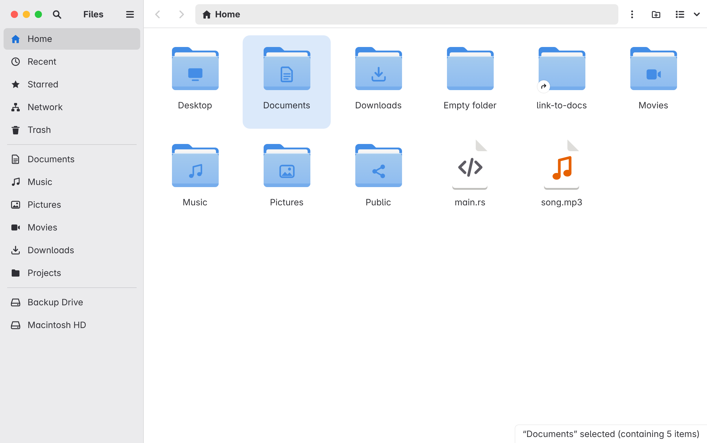
</picture>

## Screenshots

| Light | Dark |
| --- | --- |
|  | 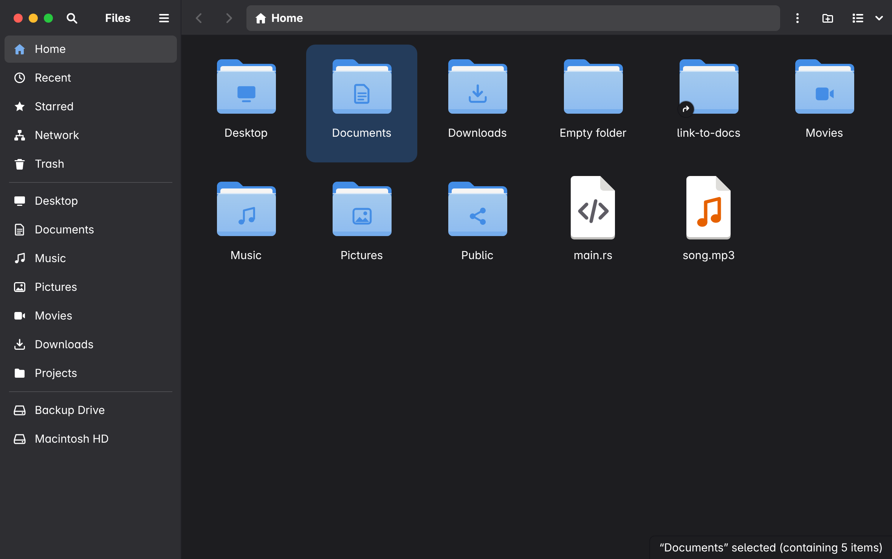 |
| **List view** with sizes, item counts and GNOME-style dates | |
| 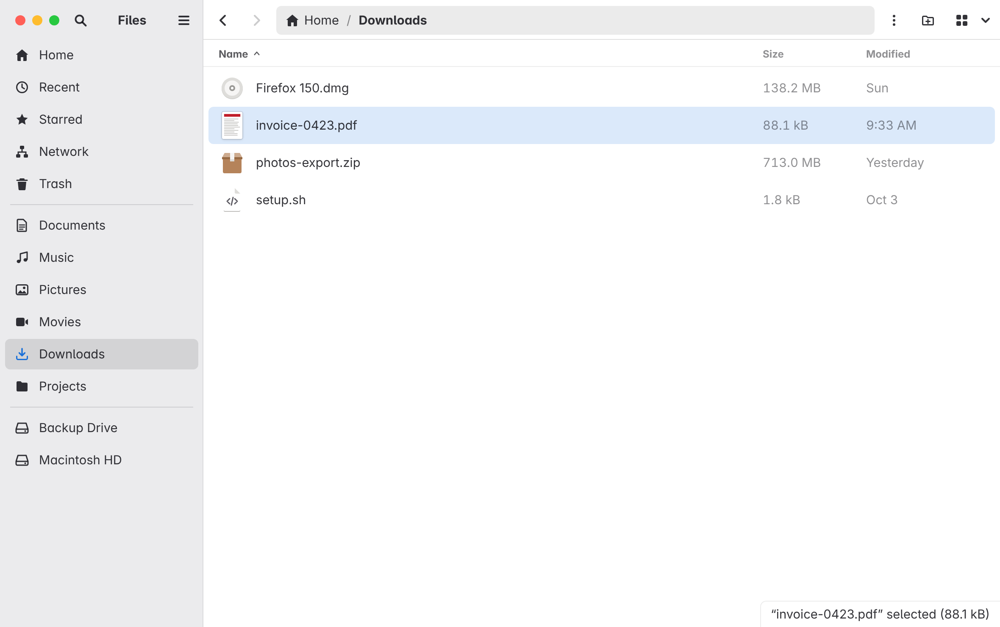 | 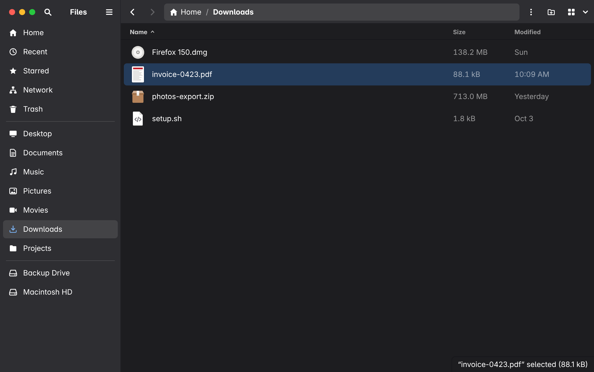 |
| **Thumbnails** for photos, videos, PDFs and documents | |
| 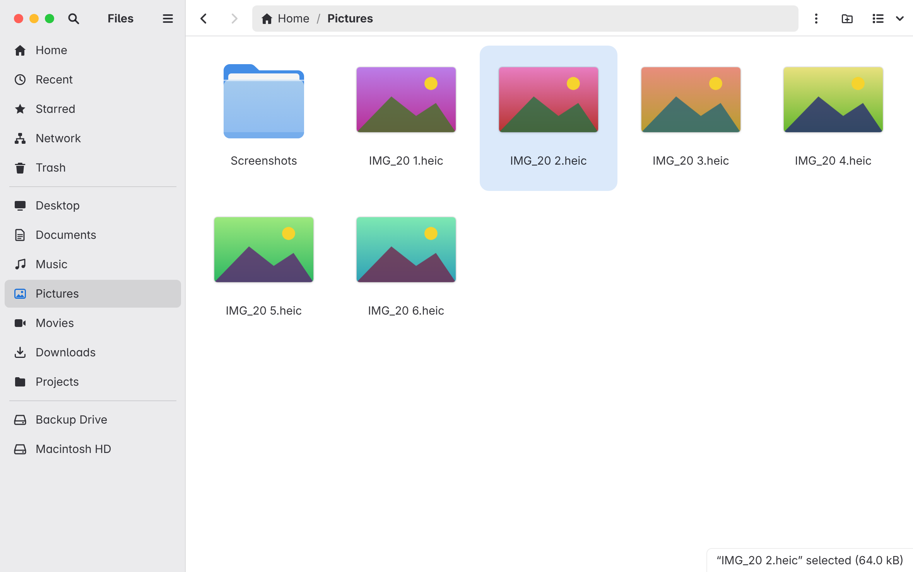 | 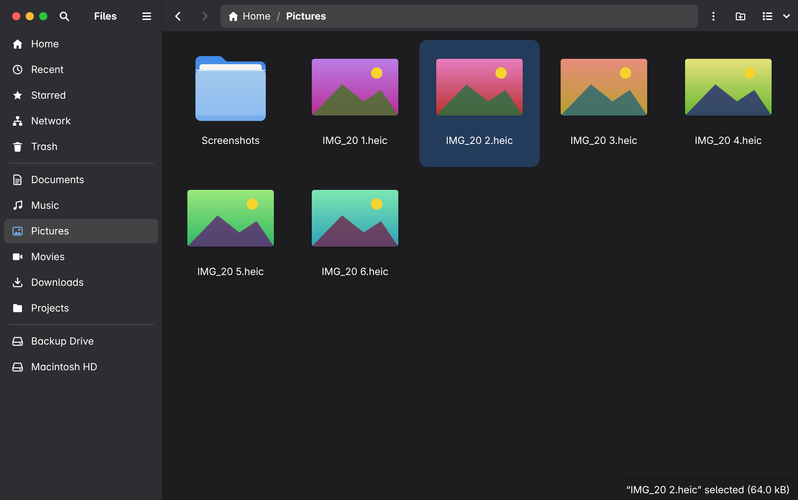 |
| **Paste with name clashes**: Replace, Skip or Keep Both | |
| 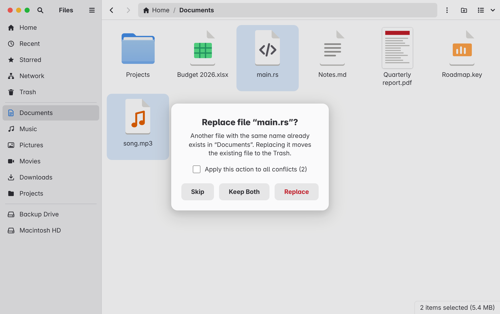 | 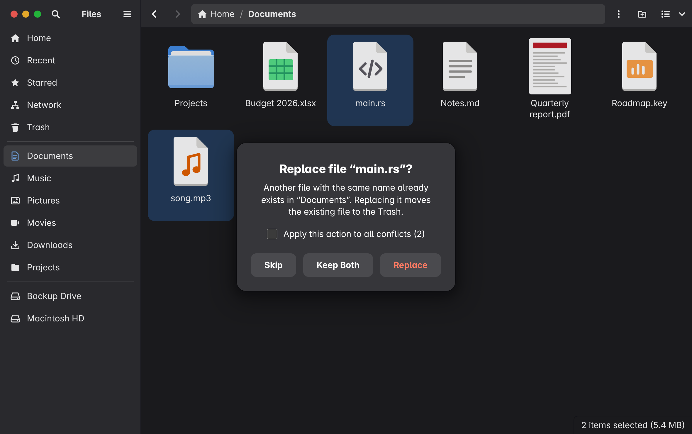 |
| **Drag and drop**, here copying two files to Music (⌥ held) | |
| 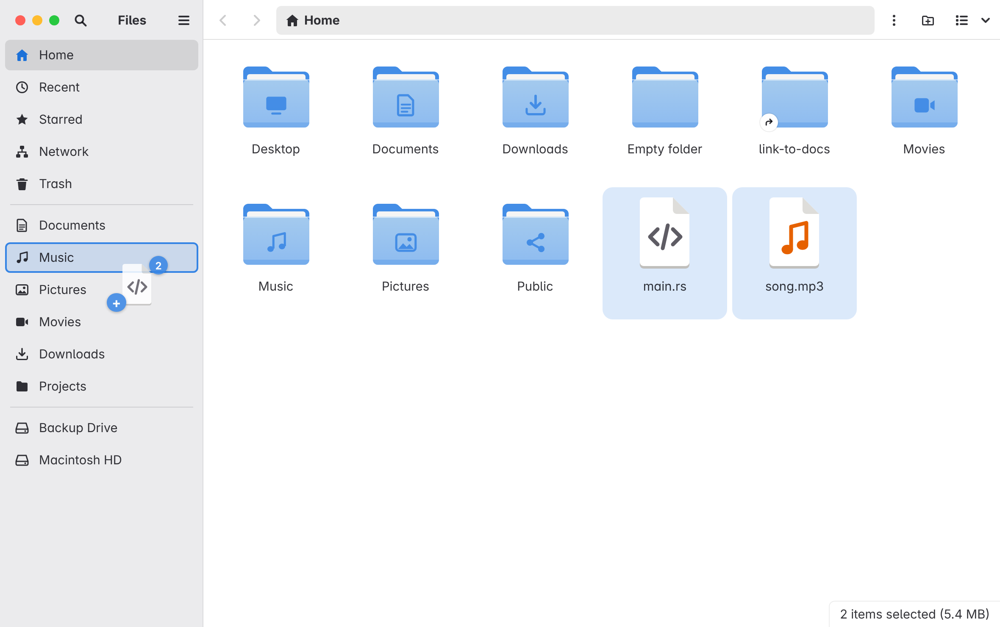 | 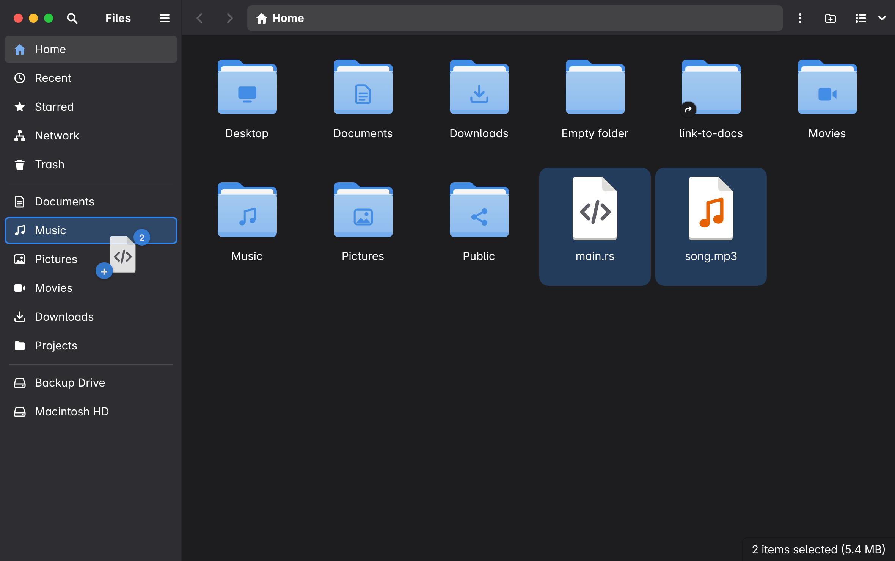 |
| **Context menus** in the libadwaita popover style | |
| 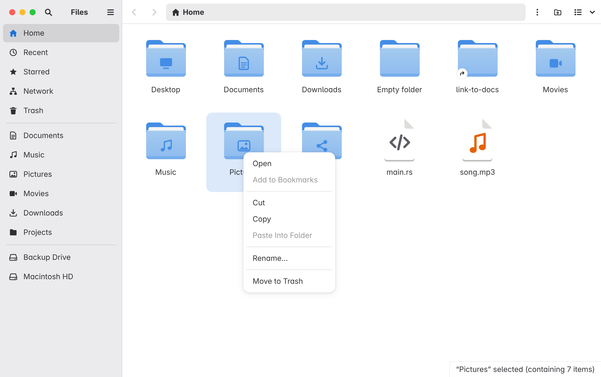 | 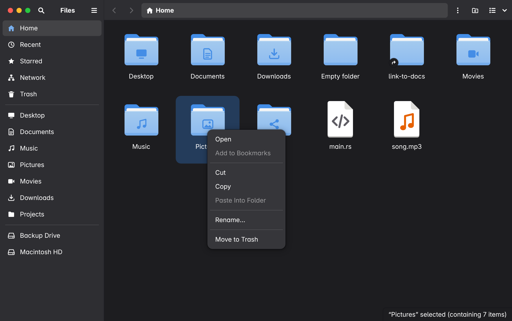 |

<sub>Screenshots are from the development preview (`npm run dev:mock`) with sample
files, so the photo thumbnails are placeholders.</sub>

## Features

- GNOME 50 look: libadwaita colours (light and dark), Adwaita Sans, Adwaita-style
  folder and file icons, header bar with path bar, split view button, popover
  menus, dialogs, toasts and banners
- Grid and list views, zoom, sorting (A–Z, Z–A, modified, size, type), hidden
  files toggle
- Path bar with breadcrumbs; ⌘L to type a location; type anywhere to filter the
  current folder
- Copy, cut, paste with Replace / Skip / Keep Both on name clashes; replacing
  sends the old item to the Trash, never deletes it
- Drag and drop: drag items onto a folder, a sidebar entry or a path-bar
  segment; hovering a folder opens it. Same disk moves, another disk copies;
  hold ⌥ to copy or ⌘ to move. Dropping on Trash trashes. Files dragged in from
  Finder land in the folder under the pointer
- Thumbnails for images (HEIC too), videos, PDFs and office documents, made by
  macOS Quick Look and cached on disk; toggle with "Show Thumbnails" in the menu
- Rename, new folder, Move to Trash with an **Undo** button in the toast (or ⌘Z)
- Trash: Original Location and Trashed On columns, **Restore From Trash** (also
  for items trashed in Finder, from its "Put Back" records), **Delete
  Permanently…** and **Empty Trash…**, both after a confirmation
- Open files in their default app (double-click or Enter); `.app` bundles launch,
  with "Show Package Contents" in the context menu
- Recent: files opened lately in any app (from Spotlight) or from here, newest
  first, with their location; "Open Item Location" and "Remove from Recent"
- Starred: star files and folders from the context menu or the star at the end
  of each list row; Starred lists them all, and stars follow renames and moves
  made in the app
- Bookmarks: "Add to Bookmarks" (⌘D) pins folders to the sidebar
- Mounted volumes in the sidebar
- Large folders stay fast: only the visible items are rendered

Press ⌘? in the app for the full list of keyboard shortcuts.

## Build and run

Requires Rust and Node.js.

```sh
npm install
npm run tauri dev      # run in development
npm run tauri build    # macOS: bundle/macos/File Browser.app
                       # Linux: bundle/deb, bundle/rpm and bundle/appimage
```

### Linux

Tauri has no bundled browser engine: on Linux it uses WebKitGTK 4.1, which is
the GTK3 generation of WebKit. Install the development headers first:

```sh
# Fedora
sudo dnf install gtk3-devel webkit2gtk4.1-devel javascriptcoregtk4.1-devel \
                 libsoup3-devel openssl-devel libxdo-devel librsvg2-devel

# Debian / Ubuntu
sudo apt install libwebkit2gtk-4.1-dev libgtk-3-dev libsoup-3.0-dev \
                 libssl-dev libxdo-dev librsvg2-dev
```

What differs from macOS is handled in `src-tauri/src/platform.rs` and
`src-tauri/src/trash_ops.rs`:

| | macOS | Linux |
| --- | --- | --- |
| Trash | `~/.Trash` | `~/.local/share/Trash` (`files/` + `info/`) |
| Put Back / restore records | Finder's `.DS_Store` | `.trashinfo` sidecars |
| Recent | Spotlight (`mdfind`) | `recently-used.xbel` |
| Mounted volumes | `/Volumes` | `/run/media`, `/media`, `/mnt` |
| Full Disk Access | checked | not applicable |

### Full Disk Access

macOS hides some folders (Mail, Safari, other apps' data, parts of `~/Library`)
from apps without **Full Disk Access**. Until it's granted the app shows a banner
with a button that opens the right page in System Settings → Privacy & Security.
Turn on "File Browser" there and restart the app.

The app is signed ad hoc (no Apple Developer ID), so macOS ties the grant to that
exact build: after rebuilding, toggle the permission off and on again.

## Development

- `npm run dev:mock` opens the UI in a normal browser at http://localhost:1420
  with a fake in-memory filesystem (`dev/mock-tauri/`), handy for UI work without
  the Rust side. Type `/big` in the path bar for a 10,000-item folder; add `?demo`
  to the URL to hide the test-only folders.
- `cd src-tauri && cargo test` runs the backend tests (listing, copy/move/trash
  safety checks, settings files, thumbnails, Recent, Trash, volumes). On a host
  without the GTK/WebKit headers, run the same command through the rootless
  container in `dev/tauri-linux.Containerfile`.
- Thumbnails are cached in the app cache directory (`~/Library/Caches/…` on
  macOS, `~/.cache/…` on Linux); entries unused for 60 days are removed at
  startup.
- Design notes and the implementation plan live in `docs/superpowers/`.

## Not supported yet

Network is a placeholder; Undo covers only the last Move to Trash; the Trash
view shows the home Trash, not the Trash folders of other drives; there is no
dragging files out of the app into Finder or other apps, no tabs, and no
disk-wide search.

On Linux, everything except the shell works the same way, but:

- Thumbnails cover image formats only — there is no Quick Look equivalent, so
  videos, PDFs and office documents get their file-kind icon instead.
- "Recent" reads GTK's `recently-used.xbel`, so it only knows about files opened
  by apps that maintain that list.
- The window uses the desktop's own title bar rather than a libadwaita header bar.

## Credits and thanks

All credit for the design goes to the people behind GNOME. This project only
tries to bring their work to other desktops.

- **The GNOME Files (Nautilus) team and contributors.** The layout, behaviour
  and wording of this app (the sidebar, path bar, views, menus, dialogs and
  messages such as "Folder is Empty") follow GNOME Files. Thank you for the file
  manager this project is trying to imitate.
  [apps.gnome.org/Nautilus](https://apps.gnome.org/Nautilus/) ·
  [gitlab.gnome.org/GNOME/nautilus](https://gitlab.gnome.org/GNOME/nautilus)
- **The libadwaita developers and the GNOME design team.** The colours,
  spacing and widget styles follow libadwaita and the
  [GNOME Human Interface Guidelines](https://developer.gnome.org/hig/).
- **The Adwaita icon theme designers.** The icons here are original drawings
  made in the Adwaita style; no icon files were copied.
- **Adwaita Sans** by the Inter Project Authors, Renzhi Li, Jamie Gravendeel and
  Florian Müllner, bundled unmodified under the SIL Open Font License 1.1
  (`src/assets/fonts/AdwaitaSans-LICENSE.txt`).
- **[Tauri](https://tauri.app/)** and the Rust crates this app builds on,
  including [`trash`](https://crates.io/crates/trash) and
  [`image`](https://crates.io/crates/image).

## Trademarks

"GNOME" and the GNOME logo are trademarks of the GNOME Foundation. Apple, Mac,
macOS and Finder are trademarks of Apple Inc. These names are used only to
describe what this project is inspired by and runs on; no endorsement is
implied.

## License

Copyright © 2026 ahmadsayed.

This program is free software: you can redistribute it and/or modify it under
the terms of the **GNU General Public License, version 3 or (at your option) any
later version** (`GPL-3.0-or-later`), the same license GNOME Files uses. See
[`LICENSE`](LICENSE) for the full text.

This program is distributed in the hope that it will be useful, but WITHOUT ANY
WARRANTY; without even the implied warranty of MERCHANTABILITY or FITNESS FOR A
PARTICULAR PURPOSE.

### Third-party licenses

- The bundled Adwaita Sans font stays under the SIL Open Font License 1.1.
- Rust crates and npm packages are under MIT, Apache-2.0, BSD, ISC, Zlib,
  Unicode-3.0, Unlicense or MPL-2.0 licenses, all compatible with GPL-3.0.
- A built `.app` carries this project's license and the font license in
  `Contents/Resources/licenses/`. If you publish built binaries, also include
  the dependencies' notices (for example with
  [`cargo-about`](https://github.com/EmbarkStudios/cargo-about)).
